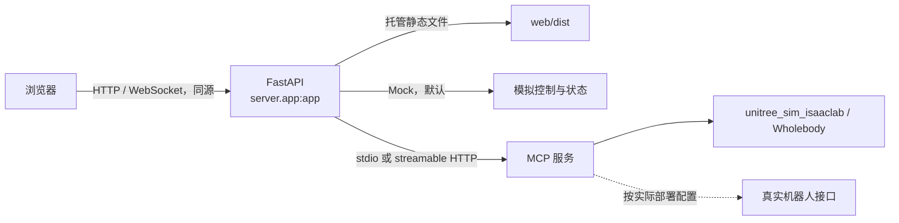

# 网页操控仿真机器人

通过浏览器控制机器人仿真任务的 Web 项目。FastAPI 提供后端接口并同源托管前端构建产物；默认使用 **Mock 模式**，无需连接真实机器人或 MCP 服务即可体验页面和模拟控制流程。

> 本文只说明部署与配置方法，不表示真实 MCP、仿真器或真机连接已经测试通过。

## 架构



## 环境要求

- Ubuntu/Linux（优先部署环境）或 macOS（开发环境）
- Python 3.10 或更高版本，且支持 `python3 -m venv`
- Node.js 20 或更高版本，以及 npm

安装脚本只操作项目内的 `.venv`、`web/node_modules` 和 `web/dist`，不会自动使用 `sudo` 或修改系统环境，可重复执行。

## 快速开始（Mock）

```bash
chmod +x *.sh
./start.sh
```

首次启动会自动执行 `install.sh`：创建 `.venv`、安装根目录 `requirements.txt`、安装前端依赖并构建 `web/dist`。以后可直接启动；需要重新安装或构建时运行 `./install.sh`。

打开：<http://127.0.0.1:8000>

服务在终端前台运行，按 **Ctrl+C** 停止。`stop.sh` 只显示停止提示，不会模糊结束其他进程。若端口被占用，请先停止对应进程，或修改端口：

```bash
PORT=8001 ./start.sh
```

默认配置为：

```dotenv
ROBOT_CONTROL_MODE=mock
HOST=127.0.0.1
PORT=8000
```

Mock 返回的是软件模拟的控制结果与状态，不能据此判断 MCP 服务、仿真器或真机已连接。

## 配置文件

复制模板后再修改：

```bash
cp .env.example .env
```

`.env` 已被 `.gitignore` 排除。启动脚本按纯文本 `KEY=VALUE` 读取它，支持空行和整行 `#` 注释，**不执行 Shell 命令、不展开变量，也不处理引号或行尾注释**。值中的空格会保留；JSON 参数应写在一行。不要把密钥提交到版本库。

### stdio MCP

适用于后端通过子进程启动 MCP 服务：

```dotenv
ROBOT_CONTROL_MODE=mcp
MCP_TRANSPORT=stdio
MCP_SERVER_COMMAND=python3
MCP_SERVER_ARGS=["/absolute/path/to/your_mcp_server.py"]
MCP_SERVER_CWD=/absolute/path/to/your_mcp_project
MCP_HTTP_URL=
```

将命令、参数和工作目录替换为实际 MCP 服务配置。`MCP_SERVER_ARGS` 必须是 JSON 数组；不要写成 Shell 命令字符串。

### streamable HTTP MCP

适用于连接已经独立启动的 MCP HTTP 服务：

```dotenv
ROBOT_CONTROL_MODE=mcp
MCP_TRANSPORT=streamable_http
MCP_HTTP_URL=http://127.0.0.1:9000/mcp
MCP_SERVER_COMMAND=
MCP_SERVER_ARGS=[]
MCP_SERVER_CWD=
```

地址仅为示例，必须改成实际服务地址。使用前需自行确认 MCP 服务已启动、协议和路径正确；本项目不会用 Mock 成功来冒充真实连接成功。

### MCP 工具与 Schema

工具名可通过 `.env` 配置，但默认名称及参数必须与 MCP 服务实际注册的 Schema 一一对应：

| 默认工具名 | 调用参数 |
| --- | --- |
| `move_velocity` | `x_vel`、`y_vel`、`yaw_vel`、`height` |
| `stop_robot` | 无参数 |
| `reset_pose` | `category` |
| `get_robot_state` | 无参数 |
| `set_gripper` | `position` |
| `list_capabilities` | 无参数 |

特别检查参数拼写：`move_velocity(x_vel, y_vel, yaw_vel, height)`、`stop_robot()`、`reset_pose(category)`、`get_robot_state()`、`set_gripper(position)`、`list_capabilities()`。如果服务端 Schema 不同，应先统一接口，不能只修改页面显示名称。

## 迁移到 Ubuntu

1. 将整个项目目录复制到 Ubuntu，保留 `web/package-lock.json`（如有），不要依赖原机器上的 `.venv` 或 `web/dist`。
2. 手动安装系统依赖。Python 包示例：

   ```bash
   sudo apt update
   sudo apt install python3 python3-venv python3-pip
   ```

   再通过 Node.js 官方发行版或你信任的版本管理器安装 Node.js 20+ 和 npm。完成后确认：

   ```bash
   python3 --version
   node --version
   npm --version
   ```

3. 在项目根目录创建并编辑配置：

   ```bash
   cp .env.example .env
   ```

   Mock 可保持默认；真实 MCP 则按上节修改传输方式、命令/URL 和工具名。
4. 启动：

   ```bash
   chmod +x *.sh
   ./start.sh
   ```

`start.sh` 会自动补齐缺失的虚拟环境和前端构建产物。Ubuntu 上若使用非本机访问，可将 `HOST` 设为 `0.0.0.0`，同时自行配置防火墙和访问控制；不要未经保护直接暴露控制接口。

## 仿真与真机安全

- 使用 `unitree_sim_isaaclab` 时，先启动并进入 **Wholebody** 任务，再启动或连接本项目的真实 MCP 模式。
- 仿真与真机的 DDS 网络域、话题和接口必须隔离，避免仿真控制消息误入真机；具体隔离参数以实际机器人与仿真环境文档为准。
- 页面或 API 的“停止”只是软件停止请求，**不是硬件急停**。真实设备必须配备独立、可立即触达的硬件急停，并在低风险环境下验证。
- 初次联调应确认运动范围、速度限制、复位姿态和夹爪状态，人员远离机器人运动区域。

## 故障排查

- **提示 Python/Node.js 缺失或版本过低**：按环境要求安装后重新运行；Ubuntu 还需确认 `python3-venv`。
- **提示端口占用**：更换 `PORT`，或自行确认并停止占用者。脚本不会替你终止未知进程。
- **后端依赖安装失败**：检查网络、Python 版本和 `requirements.txt`，然后重跑 `./install.sh`。
- **前端依赖或构建失败**：进入 `web/` 查看 npm 错误；有锁文件时使用 `npm ci`，修复后重新构建。
- **页面不是最新版本**：运行 `./install.sh` 重新生成 `web/dist`，再重启服务。
- **真实 MCP 无法连接**：先切回 Mock 验证 Web 服务，再检查 `MCP_TRANSPORT`、stdio 路径/JSON 参数或 HTTP URL，以及 MCP 工具名和 Schema。
- **仿真无响应**：确认 Wholebody 任务已先启动，检查仿真与真机 DDS 隔离及 MCP 日志；不要依赖软件停止代替硬件急停。

## 开发命令

```bash
# 完整安装并构建前端
./install.sh

# 后端开发模式（先完成安装，使用 Mock）
ROBOT_CONTROL_MODE=mock .venv/bin/python -m uvicorn server.app:app --reload --host 127.0.0.1 --port 8000

# 前端开发服务器（另开终端）
cd web
npm run dev

# 前端生产构建
cd web
npm run build

# 若项目已提供 pytest 测试，可在根目录运行
.venv/bin/python -m pytest
```

前端开发服务器的端口和代理以 `web/vite.config.ts` 为准；通过 FastAPI 访问同源生产页面时，应先执行前端构建。
